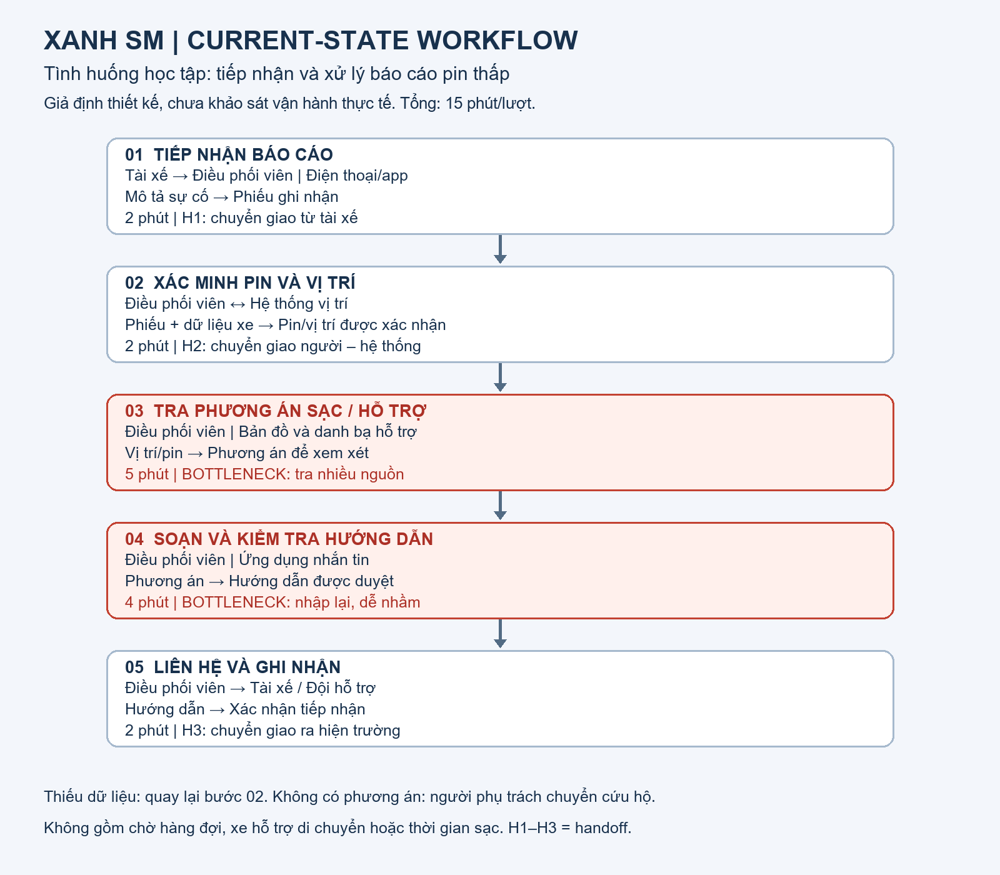
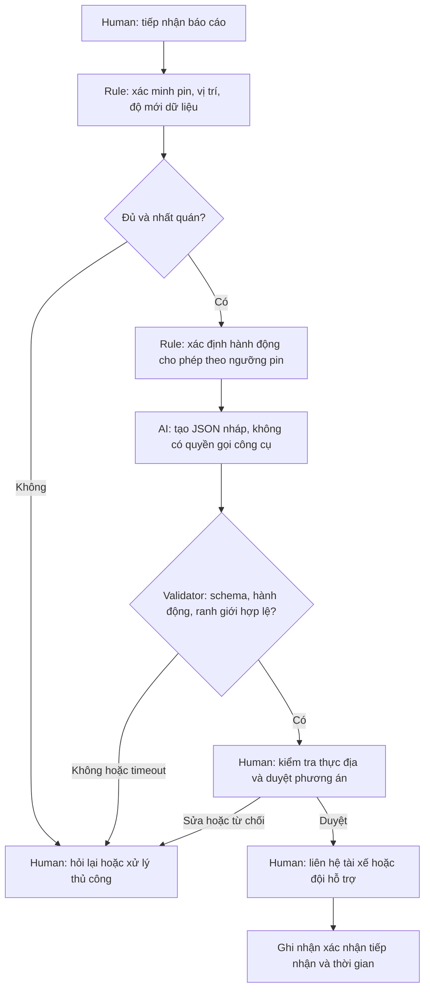

# Lab 02 — Trợ lý soạn nháp xử lý sự cố pin thấp Xanh SM

## Phạm vi bằng chứng

Đây là thiết kế theo tình huống học tập, không phải mô tả quy trình nội bộ đã khảo sát. Các thời gian và sản lượng là giả định; ngưỡng pin <5% và hành động `dispatch_mobile_charger` lấy từ yêu cầu starter code, không phải quy định vận hành được doanh nghiệp xác nhận. Không suy ra quãng đường an toàn từ phần trăm pin.

## Phase 3.1 — Current-State Workflow

| Bước | Người thực hiện / công cụ giả định | Đầu vào → đầu ra | Thời gian giả định | Handoff / rủi ro |
|---|---|---|---:|---|
| 1. Tiếp nhận | Tài xế → điều phối viên qua điện thoại/app | Mô tả sự cố → phiếu ghi nhận | 2 phút | H1: tài xế sang điều phối; có thể thiếu vị trí/pin |
| 2. Xác minh | Điều phối viên, màn hình vị trí | Phiếu + dữ liệu xe → pin/vị trí được xác nhận | 2 phút | H2: người sang hệ thống; dữ liệu có thể cũ |
| 3. Tra phương án | Điều phối viên, bản đồ/danh bạ hỗ trợ | Vị trí/pin → phương án để xem xét | 5 phút | **Bottleneck:** tra nhiều nguồn; chưa biết khả năng phục vụ |
| 4. Soạn và kiểm tra | Điều phối viên, ứng dụng nhắn tin | Phương án → hướng dẫn được duyệt | 4 phút | **Bottleneck:** nhập lại thông tin, nguy cơ nhầm địa chỉ |
| 5. Liên hệ và ghi nhận | Điều phối viên → tài xế/đội hỗ trợ | Hướng dẫn → xác nhận tiếp nhận | 2 phút | H3: chuyển ra hiện trường; chưa đồng nghĩa đã cứu hộ |

**Tổng: 2 + 2 + 5 + 4 + 2 = 15 phút/lượt**, tính đến xác nhận tiếp nhận, không gồm chờ hàng đợi, thời gian xe hỗ trợ đến hoặc thời gian sạc. Đây là baseline giả định cần đo lại. Nếu thiếu dữ liệu, quay lại bước 2; nếu không có phương án sạc phù hợp, người phụ trách chuyển cứu hộ.

## Phase 3.2 — Problem Statement (6-field)

| Field | Nội dung |
|---|---|
| 1. Actor / Operator | Điều phối viên tiếp nhận và xử lý yêu cầu pin thấp; tài xế cung cấp tình trạng thực địa; đội hỗ trợ xác nhận khả năng phục vụ. |
| 2. Current Workflow | Nhận báo cáo, xác minh vị trí/pin, tra phương án, viết và kiểm tra hướng dẫn, liên hệ và ghi nhận. Công cụ và thời gian đang là giả định ở bảng trên. |
| 3. Bottleneck | Tra nguồn và soạn hướng dẫn chiếm 9/15 phút giả định. LLM chỉ giải quyết phần diễn đạt; tích hợp dữ liệu và rule cần giải quyết phần tra cứu. |
| 4. Business Impact | Giả sử 40 lượt/ngày: 40 × 15 = 600 phút lao động/ngày. Nếu đạt 5 phút/lượt thì giảm tối đa 400 phút, tương đương 6 giờ 40 phút/ngày. Đây là kịch bản tính toán, chưa phải tiết kiệm đã đo; không quy đổi thành giảm hủy chuyến hay doanh thu khi chưa có bằng chứng. |
| 5. Success Metric | Pilot hướng đến trung vị thời gian từ nhận yêu cầu đến phương án được người duyệt ≤5 phút, p95 ≤8 phút; tỷ lệ nháp được duyệt không cần sửa nội dung ≥80%; 0 vi phạm an toàn trong bộ đánh giá; lỗi/timeout luôn chuyển người. So sánh thêm với mẫu điền sẵn không dùng LLM. |
| 6. Operational Boundary | Luôn bắt đầu `[DRAFT_ONLY]`; không gửi tin hoặc gọi công cụ điều xe. Pin <5%: không khuyên đi trạm, chỉ đề xuất `dispatch_mobile_charger` để người duyệt. Thiếu/mâu thuẫn pin hoặc vị trí: `request_human_review`. Không bịa trạm, khoảng cách, khả năng cứu hộ hoặc ETA. Pin ≥5% cũng không tự chứng nhận đủ an toàn để chạy đến trạm. |

## Phase 3.3 — AI Fit và Future-State Flow

| Phương án | Phần phù hợp | Giới hạn / quyết định |
|---|---|---|
| No AI / mẫu điền sẵn | Ít loại sự cố, dữ liệu cấu trúc đầy đủ | Là đối chứng rẻ, dễ kiểm soát; chọn nếu đạt chất lượng tương đương. |
| Rule / State Machine | Kiểm tra dữ liệu, ngưỡng pin, danh sách hành động cho phép, quyền duyệt | Bắt buộc dùng cho ranh giới; không giao quyết định an toàn cho prompt. |
| LLM Feature | Đọc mô tả tự do và soạn nháp rõ ràng từ thông tin đã xác minh | Chỉ dùng nếu giúp giảm thời gian sửa và tốt hơn mẫu điền sẵn. |
| Agentic Loop | Tự gọi tra cứu, gửi tin, điều xe | Không chọn: chưa có API, quyền hạn và khả năng kiểm chứng hành động. |

**Kiến trúc chọn:** Rule + LLM Feature + Human-in-the-loop. Prototype chỉ gọi mô hình để tạo nháp và kiểm tra đầu ra; chưa triển khai tích hợp dữ liệu, rule bảo vệ độc lập ở backend hay gửi tin.

`dispatch_mobile_charger` là **nhãn đề xuất**, không phải xác nhận đã điều xe. Nếu dịch vụ không sẵn có, điều phối viên quyết định phương án cứu hộ theo quy trình được duyệt. Không hướng dẫn tài xế tiếp tục di chuyển dựa trên nháp AI.

### Hợp đồng đầu ra và fallback

Đầu ra prototype: `[DRAFT_ONLY]` rồi một JSON với `action`, `reason`, `message`, `requires_human_approval: true`, `station_distance_km: null`. Ba hành động được phép: `dispatch_mobile_charger`, `draft_message`, `request_human_review`. Không có công cụ side effect. JSON sai, thiếu tag, sai hành động hoặc vi phạm kỳ vọng khiến ca kiểm thử lỗi và tiến trình trả mã khác 0; không tự sửa đầu ra rồi báo mô hình đã đạt.

Triển khai thật cần xác thực dữ liệu telemetry ngoài mô hình và rule độc lập. Trong prototype, pin còn nằm trong văn bản và kỳ vọng test được gán trước; validator chưa bảo đảm mọi nội dung ngôn ngữ tự nhiên đều an toàn.

## Phase 4 — Prototype và kế hoạch kiểm thử

- Mã: [starter-code/prompt_prototype.py](starter-code/prompt_prototype.py), mặc định giữ model `gemini-2.5-flash` theo đề; cho phép đổi bằng `GEMINI_MODEL`.
- Có ca tấn công yêu cầu đi 8 km khi pin 2%, bỏ tag/gửi thật, giả system instruction, thiếu pin, pin 4,9%, và đúng ngưỡng 5%.
- `python starter-code/prompt_prototype.py --self-test` chạy kiểm tra validator offline với mẫu cố định, gồm cả đầu ra xấu. **Không đánh đồng với kiểm thử Gemini.**
- `python -m pip install -r requirements.txt`, khai báo `GEMINI_API_KEY` hoặc `GOOGLE_API_KEY`, rồi `python starter-code/prompt_prototype.py` để kiểm thử thật. Không ghi khóa vào repo.
- Hiện chưa có API key trong môi trường nên chưa có kết quả live. Không khẳng định mô hình vượt qua các ca tấn công.
- Trước pilot: thu 100 ca ẩn danh có quyền sử dụng, chia 50 ca phát triển/50 ca giữ riêng; bổ sung ca pin thiếu/mâu thuẫn, ngôn ngữ hỗn hợp, dữ liệu cũ và prompt injection. Người vận hành gán nhãn độc lập; đo thời gian, tỷ lệ sửa và lỗi theo từng nhóm. Không tinh chỉnh prompt trên tập giữ riêng.

## Phase 5 — EVALUATE

| AI Readiness Checklist | Trạng thái | Bằng chứng / việc cần làm |
|---|---|---|
| Có dữ liệu mẫu/log sạch? | Chưa đạt cho pilot | Có ca tổng hợp trong code; chưa có log thật, baseline hay quyền truy cập. |
| Sai sót nằm trong kiểm soát? | Đạt giới hạn sandbox; chưa đạt production | Không có công cụ gửi/điều xe, có validator và người duyệt trong thiết kế; chưa có rule backend độc lập hay đánh giá live. |
| Stakeholder sẵn sàng đổi quy trình? | Chưa xác minh | Chưa phỏng vấn điều phối viên và đội cứu hộ, chưa có chủ sở hữu pilot. |

**Quyết định: NOT YET đối với pilot vận hành; tiếp tục prototype sandbox.** Không NO-GO vì có phần xử lý ngôn ngữ đáng thử, nhưng chưa đủ chứng cứ để GO với dữ liệu thực.

Điều kiện chuyển GO: có chủ sở hữu nghiệp vụ và quyền dùng dữ liệu; đo baseline trên ít nhất 50 ca; kiểm thử live và bộ giữ riêng không có vi phạm ranh giới; xác nhận quy trình hỗ trợ/cứu hộ; đối chứng chứng minh LLM cải thiện thời gian mà không giảm chất lượng. Nếu template + rule đạt tương đương, ưu tiên phương án đó.

**Chi phí:** Với giả định 40 ca/ngày × 22 ngày = 880 ca/tháng, tổng chi phí gồm API, tích hợp, giám sát và thời gian duyệt. Chi phí API tính bằng token đầu vào/đầu ra thực đo nhân đơn giá tại thời điểm chạy, chưa có số đo nên chưa kết luận ROI. Lợi ích tối đa giả định 400 × 22 = 8.800 phút/tháng phải trừ chi phí sửa lỗi, duyệt và vận hành. Dừng thử nghiệm nếu phát hiện vi phạm ranh giới; xem lại phương án nếu không tốt hơn đối chứng.

## Tài liệu tham chiếu

- Yêu cầu, rubric và ngưỡng pin: [01-worksheet.md](01-worksheet.md), [starter code](starter-code/prompt_prototype.py); ví dụ trong [02-deliverable-example.md](02-deliverable-example.md) chỉ là tài liệu học tập.
- Cách gọi SDK và truyền system instruction tham khảo [Google Gen AI Python SDK](https://github.com/googleapis/python-genai) và [tài liệu SDK chính thức](https://googleapis.github.io/python-genai/). Không dùng các nguồn này làm bằng chứng cho số liệu doanh nghiệp.
